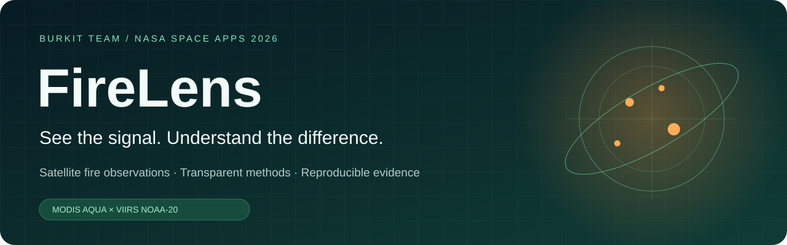
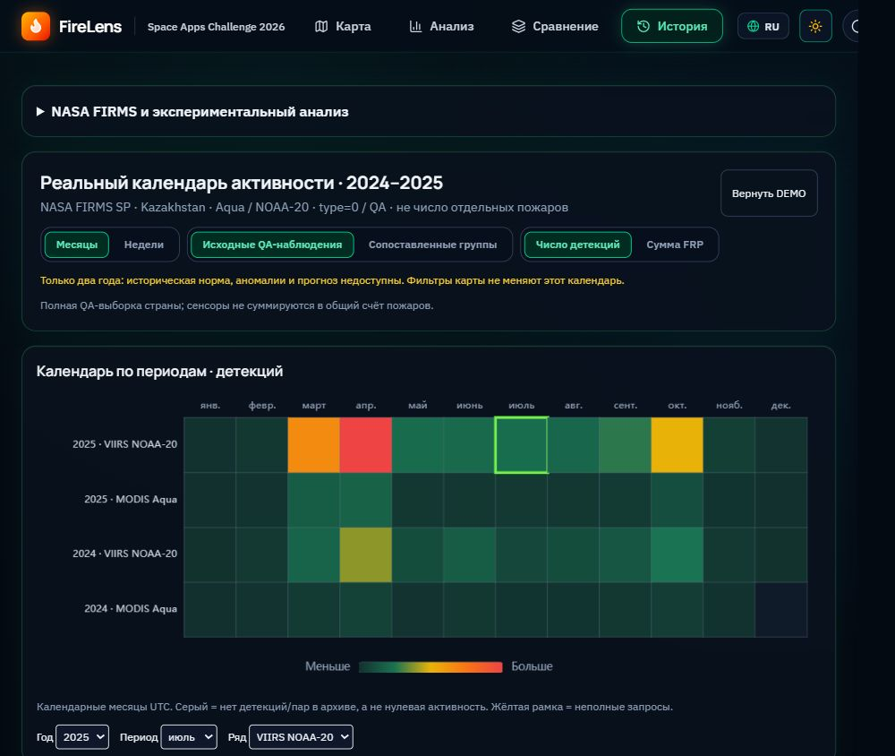
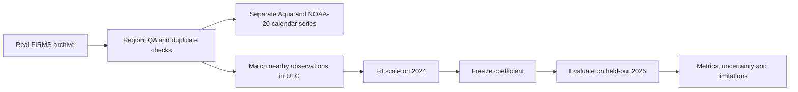

<div align="center">



**Explore satellite fire observations. Compare sensors with evidence.**

[](https://firms.modaps.eosdis.nasa.gov/)


[Overview](#why-firelens) · [Explore the app](#from-observation-to-evidence) · [Results](#what-the-experiment-shows) · [Run locally](#run-firelens-locally) · [Limitations](#read-this-before-interpreting-the-results)

**Burkit Team · NASA Space Apps Challenge 2026 · Universal Event**

</div>

## Why FireLens?

A brighter fire map does not automatically mean more fires. MODIS and VIIRS observe the same planet with different spatial resolutions, sensitivities and overpass characteristics. A change in the sensor can change the apparent signal.

**FireLens makes those differences visible and inspectable.** It brings NASA FIRMS observations, an interactive map, a real two-year activity calendar and a reproducible sensor-comparison experiment into one interface.

Our question is practical: **when Aqua and NOAA-20 observe nearby activity at similar times, how do their reported fire radiative power values compare?**

> **Research prototype.** FireLens is not a scientifically validated fire-warning system. Detection counts are not unique fire counts. Experimental cross-sensor agreement does not establish ground truth.

## From observation to evidence

| Explore | What you can do |
|:--|:--|
| **Interactive map** | Inspect observations, search places or coordinates, select a region and use geographic boundaries. |
| **Four basemaps** | Switch between standard, dark, satellite imagery and topographic views, independently of the site theme. |
| **Accessible presentation** | Use English or Russian, light or dark themes and a compact layer panel. |
| **Real NASA data** | Load recent FIRMS observations through a server route, import CSV/JSON or open bundled historical cases. |
| **Activity calendar** | Explore monthly and seven-day series for Aqua and NOAA-20 separately; inspect counts and FRP sums. |
| **Matched observations** | Inspect the restricted comparison cohort separately from the full QA-filtered archive. |
| **Evidence on the map** | Open the exact selected calendar observations on the map, then return to the same period. |
| **Reproducible outputs** | Download calendar CSV/JSON and inspect protocols, frozen coefficients, input hashes and verification scripts. |

### A calendar built from real observations



*Actual application screenshot. Kazakhstan, 2024–2025. Color represents archived observations; it does not represent a validated fire-risk score.*

| Year | MODIS Aqua QA detections | VIIRS NOAA-20 QA detections | Matched groups |
|:--|--:|--:|--:|
| 2024 | 3,231 | 19,950 | 1,518 |
| 2025 | 8,148 | 45,093 | 2,514 |

The calendar contains **76,422 QA-filtered detection records** and **4,032 matched groups**, represented in **24 monthly periods and 106 seven-day periods**. The total record count describes the dataset size; the interface keeps sensor series separate rather than adding them into a fire count.

Seven-day periods start on January 1; they are **not ISO weeks**. The final short period preserves December 30–31 in 2024 and December 31 in 2025. Its totals should not be compared directly with a full week without accounting for duration.

## What the experiment shows

### Train on 2024. Freeze. Evaluate on 2025.

The primary experiment compares **MODIS Aqua** with **VIIRS NOAA-20** inside the Kazakhstan study polygon. It uses a restricted cohort rather than treating every observation as directly comparable.



**Selection and matching**

- Aqua only on the MODIS side; NOAA-20 on the VIIRS side.
- Type `0` records; MODIS confidence ≥30 and VIIRS nominal/high confidence.
- Valid UTC timestamps and matching day/night flags.
- Maximum time lag **60 minutes** and maximum center distance **2 km**.
- Each eligible VIIRS observation is assigned once to the nearest eligible Aqua observation; assigned VIIRS FRP values are summed within its group.
- A multiplicative coefficient of **0.431357** is fitted on 2024 and frozen before evaluating 2025.

### Held-out 2025 results

| Metric · 2,514 test groups | Unscaled Aqua | Frozen-scale Aqua |
|:--|--:|--:|
| RMSE against grouped VIIRS FRP | 84.71 MW/group | **70.49 MW/group** |
| Mean bias against grouped VIIRS FRP | +6.34 MW/group | **−20.92 MW/group** |

The day-block bootstrap interval for **scaled minus unscaled RMSE** is **[−27.10, −5.36] MW/group**. RMSE improves in this held-out comparison, while **absolute bias worsens**. The training-mean baseline has test RMSE **72.80 MW/group**, so the scaled model's advantage over that simple baseline is modest.

These results support a limited statement about this protocol and these observations. **VIIRS is a comparison reference, not ground truth.** We do not claim field validation, universal sensor harmonization or a reconstructed long-term fire history.

📄 [Full overpass study and limitations](study-overpasses/REPORT_RU.md) · [Frozen model](study-overpasses/frozen-model.json) · [Protocol](docs/aqua-noaa20-protocol.json) · [Results figure](study-overpasses/results.png)

## Demo, recent data and historical evidence

| Mode | Origin | Key required? | Interpretation |
|:--|:--|:--:|:--|
| **DEMO** | Synthetic demonstration data | No | Interface exploration; not evidence of real activity. |
| **Bundled historical cases** | Archived real NASA FIRMS observations | No | Fixed, documented cases with reproducible outputs. |
| **CSV / JSON import** | Files supplied by the user | No | Coverage and provenance depend on the imported file. |
| **Recent FIRMS requests** | NASA FIRMS Area API through the local server | Yes | Recent satellite detections; not a guaranteed real-time warning service. |

Recent requests use MODIS and Suomi-NPP VIIRS; the **2024–2025 primary study uses Aqua and NOAA-20**. These are different data paths and should not be conflated.

Empty responses remain empty. Failed requests preserve the previous labeled dataset. Search and region selection do not manufacture detections. The full two-year map dataset is loaded explicitly and may take several seconds to load and verify.

## Run FireLens locally

Use **Node.js 22.12+ or Node.js 24** and npm. The bundled cases work without a NASA key.

```bash
git clone https://github.com/Aleksandr-source/burkit-team-2026-nasa-space-apps-harmonization.git
cd burkit-team-2026-nasa-space-apps-harmonization
npm ci
npm run build
npm start
```

Open **http://127.0.0.1:3001**.

### Enable recent NASA requests

Get your own [NASA FIRMS MAP_KEY](https://firms.modaps.eosdis.nasa.gov/api/). Copy `.env.example` to `.env` in the project root:

```powershell
Copy-Item .env.example .env
```

Set these values locally, then restart the server:

```dotenv
FIRMS_MAP_KEY=your_own_firms_map_key
PORT=3001
```

**Keep `.env` private.** It is excluded by `.gitignore`. Never put the key in the README, screenshots, browser code, a `VITE_` variable or a public repository.

If port 3001 is occupied, stop the existing FireLens process or choose another `PORT` in `.env` and open that port in the browser.

### Development

Run these in separate terminals:

```bash
npm run dev:api
```

```bash
npm run dev
```

Vite serves the frontend on port 3000 and forwards `/api` to port 3001 by default.

### A first walkthrough

1. Open **History → Open real calendar** and allow the bundled dataset to load.
2. Choose a year, month or week, and sensor; compare counts with FRP sums.
3. Use **Show these observations on map** to inspect the selected records.
4. Return to the calendar and switch to **Matched groups** to inspect the comparison cohort.
5. Open **NASA FIRMS & exploratory analysis** for imports, recent requests and experimental reports.

## Verification and reproducibility

A [GitHub Actions workflow](.github/workflows/verify.yml) runs the build, tests and independent calendar/overpass audits on pushes and pull requests. It requires no NASA key. Its actual run status is the source of truth for CI results.

```bash
npm run lint
npm test
npm run build
python scripts/verify-activity-calendar.py
```

The recorded local verification on **November 14, 2026** passed TypeScript checks, **22 tests**, the production build and an independent calendar audit covering **130 periods, 76,422 records, 4,032 groups and seven input SHA-256 hashes**. These are recorded checks, not a claim that GitHub CI has run.

The build still reports a large main-bundle warning. It succeeds, but loading performance needs further work before wider deployment.

To rebuild the calendar from the included study inputs:

```bash
npx tsx scripts/build-activity-calendar.ts
python scripts/verify-activity-calendar.py
```

The overpass audit is available through `python scripts/verify-overpass-study.py`; raw archive extraction and the expected archive directories may be needed for its full raw-file checks. See the study report and script for required inputs. The archived verification checked **294 raw-file hashes** as well as assignments and calculations.

For a new download and training run, follow the archive/study scripts with a local NASA key and a fresh output directory. The reviewed frozen model is protected from accidental retraining. Reproduction of exported calculations and independent scientific validation are different things.

## Read this before interpreting the results

| Limitation | What it means |
|:--|:--|
| **Detections ≠ unique fires** | Multiple pixels or passes may observe the same event. Type 0 can include agricultural burning. |
| **Missing records ≠ no activity** | Clouds, overpass timing, sensitivity and incomplete observation can affect detections. |
| **Query coverage ≠ satellite coverage** | Requested-day counts are documented; actual clear-sky observational completeness is unknown. |
| **Summed FRP ≠ energy** | Adding instantaneous MW values does not yield energy released during a period. |
| **Two years ≠ a historical baseline** | Historical normals, anomaly detection and forecasting remain unavailable. |
| **Sensor agreement ≠ accuracy** | There is no independent field reference establishing which sensor or estimate is correct. |
| **Country polygon is generalized** | Natural Earth boundaries define this study region; they are not a cadastral boundary product. |

No burned-area estimate, operational early warning, causal attribution or harmonized 2000–2026 history is claimed.

## Built with

**React 19 · TypeScript · Vite · MapLibre GL JS · Apache ECharts · Tailwind CSS · Express**

```text
src/
  components/          Map controls, imports and visual components
  pages/               Map, analysis, comparison and history views
  science/             Matching, metrics, calendar calculations and tests
  data/                Data adapters and validation
public/cases/          Bundled datasets and calendar exports
scripts/               Archive processing and independent verification
study-overpasses/      Primary 2024 → 2025 experiment and frozen model
study-2024/            Earlier cell/day experiment, retained for transparency
activity-calendar/     Calendar outputs, audit and report
docs/                  Protocols, verification records and project reports
server.mjs             Server-only NASA and place-search routes
```

## Data sources and attribution

- **NASA FIRMS:** [Area API](https://firms.modaps.eosdis.nasa.gov/api/area), [MODIS field descriptions](https://firms2.modaps.eosdis.nasa.gov/content/descriptions/FIRMS_MODIS_Firehotspots.html), [VIIRS field descriptions](https://firms.modaps.eosdis.nasa.gov/content/descriptions/FIRMS_VIIRS_Firehotspots.html). NASA supplies the observations; this project's processing and conclusions are the team's responsibility.
- **Maps:** OpenFreeMap / OpenStreetMap, Esri World Imagery and OpenTopoMap. Provider attribution remains visible in the interface; availability and reuse follow the respective providers' terms.
- **Geography and search:** Natural Earth geometry, Open-Meteo / GeoNames place search. Source place names may retain their original language.

FireLens is a team project for NASA Space Apps Challenge. It is **not an official NASA product or an endorsement by NASA**.

## Deployment status and next steps

🔐 [Secrets and deployment guide](docs/SECRETS_AND_DEPLOYMENT.md)

The documented version runs locally. No public deployment or presentation URL is asserted here.

The server currently binds to `127.0.0.1`. Public hosting requires explicit deployment configuration, server-side secrets, appropriate request limits and HTTP compression. **GitHub Pages alone cannot run the NASA and place-search server routes.** The full calendar map dataset is about **26.7 MB uncompressed**.

- [x] EN/RU interface and light/dark themes
- [x] Real FIRMS imports and bundled historical cases
- [x] Separate Aqua / NOAA-20 calendar and matched-group evidence
- [x] Frozen 2024 model and held-out 2025 comparison
- [x] Calculation tests, source hashes and independent audits
- [ ] Public hosted demonstration
- [ ] Smaller initial bundle and compressed dataset delivery
- [ ] Longer comparable history and observation-coverage modeling
- [ ] Independent external scientific validation

## Team and responsible reuse

**Burkit Team** builds FireLens to make satellite fire data easier to inspect and harder to misinterpret.

AI tools assisted development and documentation. The team remains responsible for reviewing the submitted materials, methods and claims.

No open-source license is declared in this README. Public source visibility alone does not grant reuse rights; any project license should be chosen by the repository owner. Third-party data and software retain their own terms.

📚 [Calendar report (RU)](activity-calendar/REPORT_RU.md) · [Overpass study (RU)](study-overpasses/REPORT_RU.md) · [Verification record](docs/verification.txt) · [Project report (RU)](docs/REPORT_RU.md)

---

<div align="center">

**FireLens — satellite evidence, with its uncertainty visible.**

</div>
